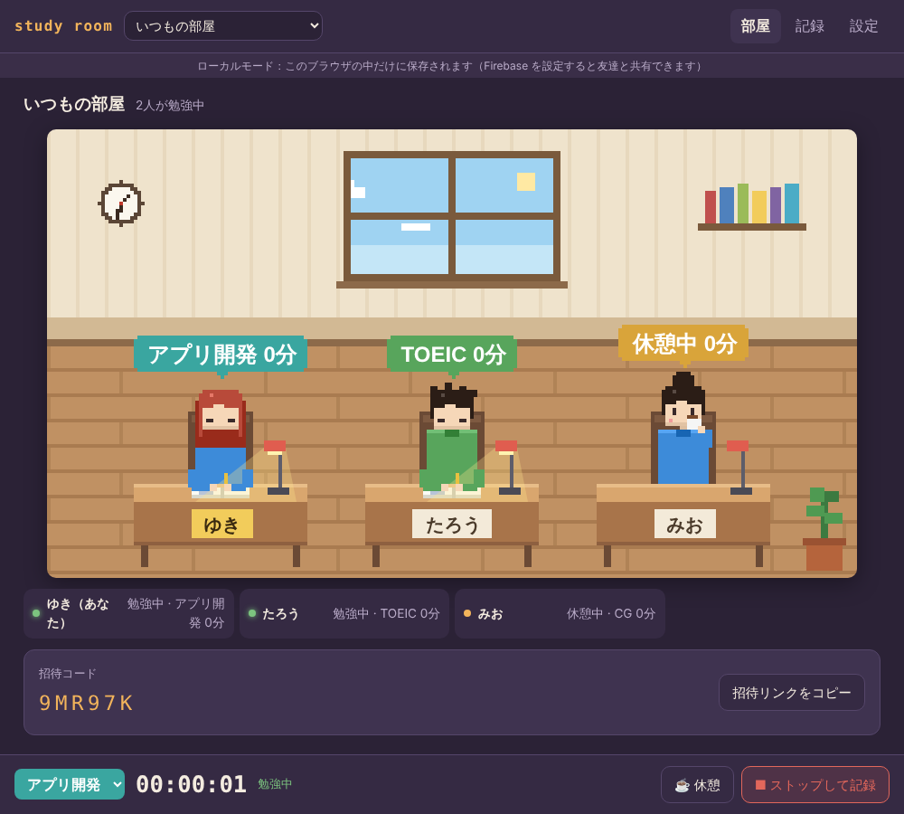

# study room（仮）

友達と「同じ部屋」で勉強できる時間記録アプリ。仕様は [SPEC.md](./SPEC.md) を参照。



アプリを開くと、友達の勉強状態が 2D の部屋でゆるく分かり、自分の勉強時間は分野ごとに記録されます。

## できること（MVP）

- **ログインと部屋への参加**：Google ログイン / ゲスト。招待コード・招待リンク（`?join=コード`）で友達だけの部屋に参加
- **固定の 2D 勉強部屋「空と水のテラス」**：入道雲と水面が見える吹き抜けのテラスに、机が 2 つ並ぶ 2 人用の部屋
- **アバター**：髪型 4 種・髪色・服の色・肌の色、机と椅子の色の組み合わせ（5 種）を選ぶだけ。状態で表示が変わる
  - 勉強中 → 机に向かってペンを動かす（クランプ式のライトが点灯）
  - 休憩中 → 伸びをする / 飲み物を飲む
  - 離席中（開いているが勉強していない）→ 空席
  - オフライン（閉じている・5 分以上更新なし）→ 机で寝ている
  - 頭の上に「分野名＋経過時間」（例：`TOEIC 45分`）
- **手動のスタート / 休憩 / ストップ**：分野を選んでスタート。休憩時間は記録に含めない。リロードしてもタイマーは続く。1 分未満は保存しない
- **ポモドーロ**：スタート前に「25分＋5分」「50分＋10分」を選ぶと、集中と休憩が自動で切り替わる（4 回目ごとに長い休憩）。休憩中はアバターも休憩の姿に
- **時間記録と集計**：週ごとの合計・前週比・日別（分野で色分け）・分野別。記録の削除、つけ忘れの手動追加
- 分野の追加・削除（初期値：学校課題 / CG / 英語 / TOEIC / 基本情報 / paiza / アプリ開発 / 映画 / イラスト）
- 空と部屋の明るさが、見ている人の現地時刻に合わせて昼・夕方・夜に変わる（夜は勉強中の人のライトだけが灯る）
- **スタンプ**：部屋の下のボタンで定型文を送ると、部屋の空を右から左へ流れる（音・通知なし）。定型文は設定の「マイセット」で最大 8 個まで編集
- **自動メッセージ**：スタート・休憩・ストップのときに固定の文章が流れる（例：`英語 50分 終わった`）。口調は ふつう / ねこ / ゆるい / 元気 から選ぶ
- **LOG**：部屋の脇の `LOG` で、流れたスタンプと自動メッセージを新しい順に 50 件まで見られる（開く前に流れたものもここで見る）。**2 日より前のものは自動で消える**（無料プランで動くよう、部屋を開いた人のアプリが消す）
- 同時に入れる部屋は 1 つ（ヘッダーで選んでいる部屋）。切り替えると前の部屋ではオフラインになる
- **タイムライン**：記録画面の上に「今日（6 時〜翌 6 時）」の帯グラフ。自分と相手の勉強した時間帯と、2 人の時間が重なった部分を並べる。相手に共有するのは分野と時刻だけ

## 動かし方

```bash
npm install
npm run dev
```

`.env` の Firebase 設定を空にすると **ローカルモード** で起動します。データはそのブラウザの localStorage だけに保存されます。
ログインはタブごとなので、別のタブで別の名前を入力して入ると、1 台で「友達のいる部屋」を試せます。

```bash
npm test             # 集計・時間計算などのテスト
npm run test:rules   # Firestore セキュリティルールのテスト（エミュレーターを自動で起動。Java が必要）
npm run build        # 型チェック + 本番ビルド（dist/）
```

### Firebase エミュレーターで動かす（本番のデータを汚さずに試す）

```bash
npm run emulators      # ターミナル1：Auth と Firestore のエミュレーターを起動
npm run dev:emulator   # ターミナル2：エミュレーターにつないでアプリを起動
```

## Firebase で友達と共有する

1. [Firebase コンソール](https://console.firebase.google.com/) でプロジェクトを作成し、Web アプリを追加
2. Authentication で **Google** と **匿名** のログインを有効にする
3. Firestore Database を作成する
4. `.env` に Web アプリの設定値を入れる（このリポジトリには studywith-9090d の値が入っています。公開前提の値なので Git に入れて問題ありません）
5. セキュリティルールとホスティングをデプロイ

```bash
npm install -g firebase-tools
firebase login
firebase use --add            # 作ったプロジェクトを選ぶ
npm run build
firebase deploy               # firestore.rules と dist/ をデプロイ
```

デプロイした URL を友達に送れば、インストールなしで使えます（Vercel などでも可。その場合も `firestore.rules` は `firebase deploy --only firestore` で反映してください）。

## 自動で公開する（GitHub Actions）

`.github/workflows/deploy.yml` で、次のように動きます。

- プッシュ・プルリクエストのたびに：型チェック・テスト・ルールのテスト・ビルド
- **既定のブランチに入ったとき（プルリクエストをマージしたとき）**：テストが通ったら `firebase deploy --only hosting,firestore` で公開（画面と Firestore のルール）

公開には、Firebase に公開してよい「鍵」（サービスアカウントの鍵）を、GitHub に 1 回だけ登録します。

1. [Google Cloud コンソールの「サービス アカウント」](https://console.cloud.google.com/iam-admin/serviceaccounts?project=studywith-9090d) で「サービス アカウントを作成」
   - 名前：`github-deploy` など
   - ロール：**Firebase 管理者** と **API キー閲覧者**
2. 作ったサービスアカウントを開き、「鍵」→「鍵を追加」→「新しい鍵を作成」→ JSON。ファイルがダウンロードされる
3. GitHub のリポジトリの Settings →「Secrets and variables」→「Actions」→「New repository secret」
   - Name：`FIREBASE_SERVICE_ACCOUNT`
   - Secret：ダウンロードした JSON ファイルの中身をそのまま貼り付け
4. ダウンロードした JSON ファイルはパソコンから削除する（この鍵があれば公開できてしまうので、人に渡したり Git に入れたりしない）

登録していない間は、テストだけが動いて公開はとばされます（Actions の画面に注意が出ます）。
登録後、すぐに公開したいときは Actions の「test-and-deploy」→「Run workflow」で手動でも動かせます。

## データ構成（Firestore）

Firestore はコレクションとドキュメントが交互になるため、仕様書の `presence/{roomId}/{userId}` は部屋の下に置いています。

```
rooms/{roomId}                      name, createdAt, memberIds[]      ※ roomId = 招待コード
rooms/{roomId}/messages/{id}        senderId, kind, text, createdAt   ※ スタンプ・自動メッセージ
rooms/{roomId}/timeline/{id}        userId, category, startedAt, endedAt
                                    ※ タイムライン用の共有コピー（id は記録と同じ。記録を消すと一緒に消える）
rooms/{roomId}/presence/{userId}    status, category, startedAt, accumulatedSec, updatedAt,
                                    displayName, avatar               ※ 部屋の描画に必要な分だけ複製
users/{userId}                      displayName, avatar{hair, hairColor, outfitColor, skin, desk}, categories[], stamps[], tone
users/{userId}/sessions/{id}        category, startedAt, endedAt, durationSec, source: "manual" | "camera"（旧データのみ）, roomId?
```

- 時刻はすべてミリ秒の数値
- `accumulatedSec`：休憩をはさんだときの、それまでの勉強秒数（相手側で経過時間を計算するため）
- ルール（`firestore.rules`）：部屋と在席情報・メッセージはメンバーだけが読める。参加は「自分を追加」（最大 2 人）、退出は「自分を削除」だけ許可。メッセージは自分の名前で 40 文字まで送れて、変更はできない（2 日より前のものはメンバーなら消せる）。タイムラインは自分の分だけ置けて、削除も本人だけ。勉強記録は本人だけが読み書きできる

## 軽さのための工夫（仕様 7.）

- 部屋のアニメーションは 12fps。タブが見えていないときは描画しない
- 状態（presence）は変わったときだけ送信。加えて「開いている」ことを伝えるため 1 分に 1 回だけ送り直し、5 分途絶えたらオフライン扱い
- Firebase SDK は設定があるときだけ読み込む（ローカルモードでは読み込まない）

## ファイル構成

```
src/
  App.tsx                   画面の切り替え（ログイン → アバター → 部屋 / 記録 / 設定）
  backend/                  保存先の窓口（firebase.ts / local.ts を同じインターフェースで）
  room/draw.ts              部屋とアバターのドット絵描画（素材なし・fillRect で描画）
  room/RoomCanvas.tsx       描画ループ（12fps・非表示時停止・整数倍拡大）
  room/comments.ts          部屋の空を流れるコメント（レーンの割り当て・吹き出しの描画）
  lib/messages.ts           自動メッセージの文章・スタンプの初期値など
  lib/timeline.ts           タイムラインの 1 日の枠・2 人の重なりの計算
  lib/pomodoro.ts           ポモドーロの集中 ⇔ 休憩の切り替え（閉じていた間の追いつきも）
  lib/record.ts             記録の保存・削除（タイムラインへのコピーも一緒に）
  hooks/useStudyTimer.ts    タイマー（localStorage に保持）
  hooks/usePresencePublisher.ts  自分の状態を入っている部屋（1 つ）へ送信
  components/               画面部品（TimerBar, Stats, Settings, RoomView など）
  lib/                      時間・集計・色・招待コードの小さな関数
```

自作の絵に差し替えるときは `src/room/draw.ts` の `drawRoom` / `drawSeat` / `drawLighting` / `drawSeatLabels` を書き換えれば、他は変えずに済みます。部屋のデザインの詳細は [SPEC.md](./SPEC.md) の 4 章にあります。

## 次のバージョンでやること

- 窓の外を「各メンバーの」現地時刻に合わせる（今は見ている人の時刻）

## 決めたこと（仕様書の「未決定」のうち仮に決めたもの）

| 項目 | 仮の値 | 変更する場所 |
|---|---|---|
| 1 部屋の最大人数 | 2 人 | `src/constants.ts` の `MAX_ROOM_MEMBERS` と `firestore.rules`（描画は人数が増えると横に広がる） |
| 絵柄・視点 | ドット絵・正面から | `src/room/draw.ts` |
| オフライン判定 | 5 分更新なし | `PRESENCE_STALE_MS` |
| 記録の見せ方 | 週単位の日別棒グラフ＋分野別横棒 | `src/components/Stats.tsx` |
